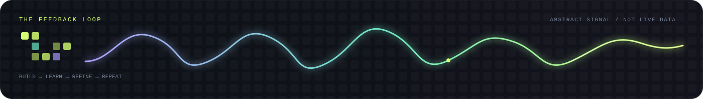

  

  
  
  

  

## About me

I'm **Tushant**, a computer science student in India focused on backend engineering and creative development. I care about reliable state transitions, failure paths, data integrity, and interfaces that communicate clearly.

I learn by shipping end-to-end projects—from database constraints and APIs to polished interactive frontends.

- **Backend & fintech:** TypeScript, Node.js, Fastify, PostgreSQL
- **Creative frontend:** React, Three.js, WebGL, Canvas
- **Currently exploring:** developer tools, observability, and applied AI

## Selected work

### [Pulse Signal Studio](https://github.com/TUSHANT-CSE/pulse) — local-first uptime monitoring

[**Live demo →**](https://tushant-cse.github.io/pulse/) &nbsp;·&nbsp; [Source](https://github.com/TUSHANT-CSE/pulse) &nbsp;·&nbsp; **69 passing tests**

Scheduled HTTP monitoring with SQLite persistence, incident timelines, SSE updates, and an accessible WebGL dashboard. The hosted demo uses synthetic data only; the real backend stays local.

- Pinned transport, redirect validation, bounded retries, and cancellation-safe concurrency
- Incident state machine with reduced-motion and Canvas2D fallback

### [PayProof](https://github.com/TUSHANT-CSE/payproof) — reconciliation-first UPI collections

Marks a payment `RECONCILED` only when its UTR and amount match an imported bank statement.

- Partial unique index and review queue for late or duplicate alerts
- Double-entry ledger, idempotent imports, and HMAC-signed webhook outbox
- **TypeScript · Fastify · PostgreSQL · PGlite · 29 tests**

### [Tushant Portfolio](https://github.com/TUSHANT-CSE/tushant-portfolio)

Privacy-first interactive portfolio built with **Three.js, Vite, and vanilla JavaScript**.

[Browse repository →](https://github.com/TUSHANT-CSE/tushant-portfolio)

### More work

| Project | Focus | Stack |
| :--- | :--- | :--- |
| [Urban Pulse](https://github.com/TUSHANT-CSE/Capstone-pro-web-development) | Smart-city complaints, analytics, and service monitoring | React, Redux Toolkit, Tailwind CSS |
| [Student Management API](https://github.com/TUSHANT-CSE/webdevassgn3) | CRUD REST API with a Postman collection | Node.js, Express |
| [Python Coursework](https://github.com/TUSHANT-CSE/PYTHON) | Gradebook, library manager, and data visualisation | Python, Jupyter |

## Stack

  

- **Languages:** TypeScript, JavaScript, Python, Java, SQL, HTML/CSS
- **Backend & data:** Node.js, Express, Fastify, PostgreSQL, PGlite, REST APIs, SQLite
- **Frontend & creative:** React, Redux Toolkit, Tailwind CSS, Three.js, WebGL, Canvas, Vite
- **Tools:** Git, GitHub Actions, Postman, Jupyter, Playwright

## GitHub at a glance

  
  

  

  

  
  

<strong>Current direction</strong>

 

I'm looking to grow through backend engineering, developer tools, observability, and projects where software needs to be both technically sound and clear to use. The common thread is simple: **build the failure path, measure the result, then make the experience feel good.**

---

Built with care for the details that usually stay invisible.

